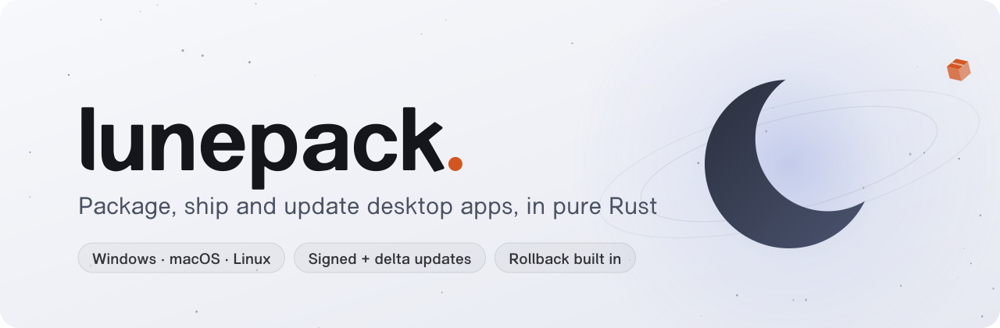
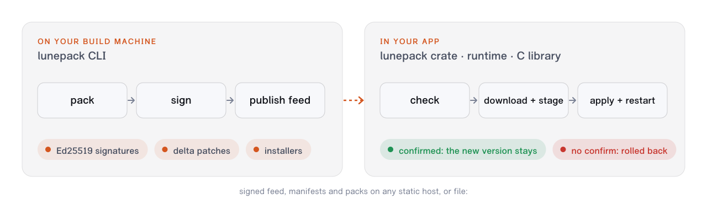

<!-- The pictures are generated by scripts/readme-assets.py (RznSans text outlined to paths). -->
<p align="center">
  <picture>
    <source media="(prefers-color-scheme: dark)" srcset="docs/images/readme/banner-dark.svg">
    
  </picture>
</p>

<p align="center">
  <a href="#-how-it-works"><b>How it works</b></a> ·
  <a href="#-whats-inside"><b>What's inside</b></a> ·
  <a href="#-in-your-app"><b>In your app</b></a> ·
  <a href="#-docs"><b>Docs</b></a> ·
  <a href="#-build-and-test"><b>Build</b></a>
</p>

<p align="center">
  
  
  
  
  
</p>

**lunepack** is a pure-Rust installer, packager and auto-updater framework. It turns an app's build
output into a **signed release that any static host can serve**, builds **installers for Windows,
macOS and Linux**, ships **full and delta updates**, then applies an update and restarts the app,
**rolling back** when the new version does not confirm that it works.

It is built first for **Lunegit**, a desktop git client, and is meant for other apps too, **in any
language**: Rust through the crate, C and C++ through the C library, and everything else through the
runtime's command line.

> [!NOTE]
> Version 0.1.0 is prepared for its first release; nothing has been published yet, so until then
> the crates and the prebuilt binaries are built from a checkout. The format is specified and frozen
> from the first published release ([`docs/FORMAT.md`](docs/FORMAT.md)).

## 🌙 How it works

<p align="center">
  <picture>
    <source media="(prefers-color-scheme: dark)" srcset="docs/images/readme/flow-dark.svg">
    
  </picture>
</p>

1. **Pack.** `lunepack pack` hashes, compresses and signs your build output into a pack and a
   manifest, verifies every file it wrote, and can add delta patches from earlier releases.
2. **Publish.** `lunepack feed add` lists the release on a channel. The release directory is plain
   files: put it on any static host, or read it from a `file:` URL.
3. **Update.** The app checks the feed, downloads (resumably, as patches where it can) and stages
   the new version, then hands over to the runtime, which swaps versions and restarts it.
4. **Confirm or roll back.** The new version calls `confirm_healthy` once it works. If it never
   does, the runtime puts the previous version back and starts it in its place.

## 📦 What's inside

| | |
| --- | --- |
| 🛠️ **`lunepack`** (the `lunepack-cli` crate) | The publisher's command line: `init`, `keys`, `pack`, `feed`, `verify`, `inspect`, `setup` and `prebuilt`. |
| 🦀 **`lunepack`** (the facade crate) | The Rust API: check, download, verify and stage an update, then apply it and restart. |
| ⚙️ **`lunepack-runtime`** | A small static program beside the app that does the same through a command line with JSON Lines output, so an app in any language can update itself. |
| 💿 **Installers and an update window** | Per-user and per-machine installs on all three systems, with an install and update UI drawn by [luneui](https://github.com/lune-rs/luneui), and a privileged update service for installs for all users. |
| 🔌 **`lunepack-ffi`** | A C library and its header (`lunepack.h`) for C and C++ apps; built from a checkout, not distributed yet. |
| 🧪 **`examples/dotnet`, `examples/c`** | A .NET app that updates itself through the runtime only, and a C app that does it through the library. |

### Highlights

- 🔐 **Trust first.** Every document is a DSSE envelope signed with Ed25519. An update is accepted
  only when the chain from the root key compiled into the app down to the files on disk verifies,
  with root key rotation and anti-rollback floors. The limits are written down in the
  [threat model](docs/THREAT-MODEL.md).
- 🪶 **Small updates.** A changed file travels as a patch against the installed one, falling back to
  the full file and then the full pack; on two real patch releases that saved 74% and 79%.
- ⏯️ **Resumable and cancellable.** Range downloads pick up where they stopped, every step can be
  cancelled, and the install state survives a crash at any point.
- ⚡ **Any executor.** `check`, `download` and `stage` are `Send + 'static` futures that run on
  tokio, smol or none at all (`lunepack::blocking`); lunepack never spawns onto your executor.
- 🖥️ **Native installs everywhere.** A `Setup.exe` on Windows, a `.dmg`, `.zip` or `.pkg` on macOS
  and a setup file on Linux; per user, or for all users through a Windows service, a systemd unit or
  a LaunchDaemon that standard users can ask to update.
- 🧱 **Swappable everything.** Network, filesystem, codecs, crypto, OS integration and the clock sit
  behind traits owned by a pure core, each with an in-memory fake and a contract suite.

## 🦀 In your app

Three calls carry the whole lifecycle ([`docs/GETTING-STARTED.md`](docs/GETTING-STARTED.md) has the
full program):

```rust
use lunepack::{ApplyOptions, CancelToken, DownloadOptions, Installation, StartupAction, blocking};

fn run() -> Result<(), lunepack::Error> {
    // 1. First thing in main: learn what happened since the last start.
    let started = lunepack::startup()?;
    if started.action == StartupAction::Exit {
        return Ok(()); // this version was rolled back; the previous one runs instead
    }

    // 2. Once the app works, confirm it. Without this, every update is rolled back.
    lunepack::confirm_healthy()?;

    // 3. Look for an update and, when there is one, hand over to the runtime.
    let install = Installation::from_current_exe()?;
    let updater = blocking::Updater::from(install.updater_builder()?.build()?);
    let cancel = CancelToken::new();
    if let Some(info) = updater.check(&cancel)? {
        let downloaded = updater.download(&info, DownloadOptions::default(), &cancel)?;
        let staged = updater.stage(downloaded, &cancel)?;
        lunepack::apply_and_restart(ApplyOptions {
            expect_version: Some(staged.version().clone()),
            ..ApplyOptions::default()
        })?;
    }
    Ok(())
}
```

Not in Rust? The runtime takes the same steps from any language
([`docs/INTEGRATION.md`](docs/INTEGRATION.md), [`docs/RUNTIME.md`](docs/RUNTIME.md)):

```sh
lunepack-runtime startup --json -- "$@"
lunepack-runtime confirm --json
lunepack-runtime download --json
lunepack-runtime apply-and-restart --json --wait-pid $$
```

And on the build machine:

```sh
lunepack init --app-id org.example.hello --root-key "$ROOT"
lunepack pack --input input --version 1.0.0 --target linux-aarch64 \
    --release-dir release --sign release --runtime lunepack-runtime
lunepack feed add --release-dir release --channel stable --version 1.0.0 --sign release
```

## 📚 Docs

| | |
| --- | --- |
| 🚀 [Getting started](docs/GETTING-STARTED.md) | From nothing to an installed Rust app that updates itself. |
| 🌐 [Integration](docs/INTEGRATION.md) | The same for an app in any language, with the .NET and C examples. |
| 🔑 [Key ceremony](docs/KEY-CEREMONY.md) | Making and keeping the signing keys, rotating and revoking them, and what a leak costs. |
| 🛡️ [Threat model](docs/THREAT-MODEL.md) | What the signing chain defends against, and what it does not. |
| 📖 Reference | [CLI](docs/CLI.md) · [runtime](docs/RUNTIME.md) · [C API](docs/C-API.md) · [format](docs/FORMAT.md) · [architecture](docs/ARCHITECTURE.md) |
| 🔒 [Security](SECURITY.md) | Reporting a vulnerability, and checking the prebuilt binaries you download. |

[`docs/RELEASING.md`](docs/RELEASING.md) is the maintainer's runbook for a release. Identifiers such
as `D19` or `M9-D8` in these documents refer to the project's internal decision log, which is not
part of this repository; where a rule matters, the document states it.

## 📥 Install

Once the first release is published:

```sh
cargo install lunepack-cli --locked   # installs the `lunepack` command
```

The prebuilt runtime, window program, update service and Windows stubs that a packager places into
an app are downloaded with `lunepack prebuilt fetch`, which checks them against hashes compiled into
the command line, or built from a checkout with `scripts/build-runtime.sh`
([`docs/CLI.md`](docs/CLI.md)). A Rust app depends on the `lunepack` crate.

## 🔧 Build and test

Rust 1.99.1 is pinned in `rust-toolchain.toml` and installed by rustup on first use.

```sh
cargo build --workspace --locked
cargo test --workspace --locked
./scripts/gate.sh   # everything the gate runs, stage by stage
```

## 📄 License

Licensed under either of [Apache License, Version 2.0](LICENSE-APACHE) or [MIT license](LICENSE-MIT)
at your option.

<p align="center"><sub>🌙 Part of <a href="https://github.com/lune-rs">lune-rs</a>, pure-Rust libraries for native apps and tools.</sub></p>
